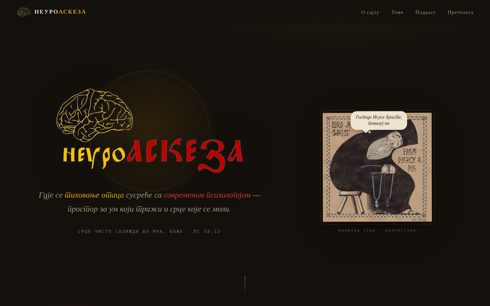

# Неуроаскеза

Православна WordPress тема за сајт **Неуроаскеза** — простор сусрета
православне теологије, психологије и савремене науке о уму, са подкастом.

Тема прати логотип (злато + литургијски гримиз), има анимирану насловну
(монах са бројаницом, десница која благосиља, икона цариника), ефекте на
сликама при прелазу курсором и једнострану насловну која се сама пуни из
објава.



---

## Шта је у репозиторијуму

```
neuroaskeza/        ← WordPress тема (ово се отпрема у WordPress)
  style.css
  functions.php
  front-page.php    ← једнострана насловна (динамичка)
  single.php        ← страница појединачног текста
  header.php, footer.php, page.php, index.php
  images/           ← логотип, знак, монах, бројаница, десница, цариник
tekstovi/           ← 13 готових текстова (HTML, за лијепљење у објаве)
  1-tihovanje.html … 13-licnost-zajednica.html
  UPUTSTVO.txt      ← упутство: категорије, слугови, подкаст, линкови
```

## Инсталација теме

1. Преузми овај репозиторијум као ZIP (дугме **Code → Download ZIP**),
   или направи ZIP само фолдера `neuroaskeza/`.
2. У WordPress-у: **Изглед → Теме → Додај нову → Отпреми тему** →
   изабери ZIP који садржи фолдер `neuroaskeza/` → **Инсталирај** → **Активирај**.
3. Направи категорије (slug тачно овако, латиницом):
   - `predanje` — „Предање Цркве" (лијева колона)
   - `psihologija` — „Савремена психологија" (десна колона)
   - `podkast` — „Подкаст" (епизоде)
4. Убаци текстове из фолдера `tekstovi/` као објаве и сврстај их у
   одговарајуће категорије. Детаљно у `tekstovi/UPUTSTVO.txt`.

## Како ради насловна

- **Колоне** „Предање Цркве" / „Савремена психологија" аутоматски
  приказују текстове из категорија `predanje` / `psihologija`, као
  кликабилне линкове (злато/окер).
- **Из писаонице** приказује 6 најновијих текстова као картице.
- **Подкаст** приказује 4 најновије епизоде из категорије `podkast`;
  YouTube линк залијепљен у објаву се сам уграђује као плејер.
- Линкови платформи (YouTube/Spotify/Apple/RSS) и форма претплате
  подешавају се у **Изглед → Прилагоди → „Неуроаскеза — линкови"**.

## Напомена о хостингу

WordPress тема захтијева PHP хостинг (нпр. Hostinger). **GitHub Pages не
може да покреће WordPress** — овај репозиторијум служи за чување и
верзионисање кода теме, не за живи WordPress сајт. (Статичка, једнофајлна
верзија сајта постоји посебно и њу је могуће хостовати на GitHub Pages.)

---

*Слава Богу за све.*
